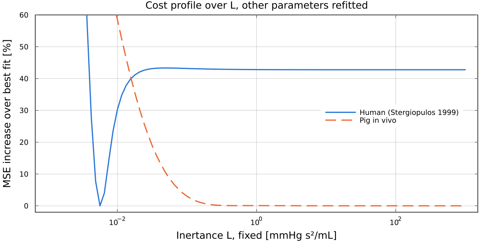

# WindkesselIdentification.jl

[](https://github.com/hpigot/WindkesselIdentification.jl/actions/workflows/CI.yml)
[](https://github.com/JuliaTesting/Aqua.jl)

Fit 2-element, 3-element and parallel 4-element Windkessel models of the cardiac afterload to
measured aortic pressure and flow. The models are simulated in discrete time (exact zero-order
hold) and fitted by output-error minimisation with Newton's method, using exact gradients and
Hessians from forward-mode automatic differentiation. The Hessian at the estimate also gives a
practical identifiability analysis.

The package is the code behind [Pigot et al. (2021), _Identification of cardiac afterload dynamics
from data_](https://doi.org/10.1016/j.ifacol.2021.10.307), IFAC-PapersOnLine 54(15), 508-513, and
ships the three data sets used there.


## Installation

```julia
] add WindkesselIdentification
```

Until the package is registered, use `] add https://github.com/hpigot/WindkesselIdentification.jl`.

## Quickstart

```julia
using WindkesselIdentification

p, q, h = load_stergiopulos1999()   # pressure [mmHg], flow [mL/s], sampling period h = 0.005 s
θ0 = [0.85, 1.5, 0.05, 0.006]       # start: Rp, C, Rc, L

# Fit the 4-element model; the initial state is solved from periodicity at every step
θ, res = identify(θ0, solvex0(G(θ0, h), q), q, p, h; x0id=false, x0solve=true)
θ                                   # [0.803, 1.25, 0.0562, 0.00547]

psim = simulate(θ, solvex0(G(θ, h), q), q, h)   # model pressure, MSE 5.74 mmHg^2
```

The 3- and 2-element models are `G3` and `G2`: pass `θid=[1, 1, 1]` (or `[1, 1]`) and `G_=G3`.
`identify` can also estimate the initial state as parameters (`x0id=true`), hold some parameters
fixed (`θid=[1, 1, 1, 0]`), or drop the positivity constraint (`θpos=false`). `identifyglobal`
uses Nelder-Mead instead. `G(θ, h)` returns a ControlSystemsBase `StateSpace` for use with that
ecosystem (`bode`, `lsim`, ...); `G(θ, h; discretize=false)` gives the continuous-time model.

### Models and units

The parallel 4-element model has impedance Z(s) = Rc + Rp/(1 + s C Rp) - Rc/(1 + s L/Rc), with
flow as input and pressure as output. The 3-element model is the limit L = Inf, and the 2-element
model has Rc = 0.

| Quantity | Unit |
|---|---|
| pressure | mmHg |
| flow | mL/s (`Lmin_to_mLs`, `mLs_to_Lmin` convert from and to L/min) |
| time, h | s |
| Rp, Rc | mmHg s/mL |
| C | mL/mmHg |
| L | mmHg s^2/mL |
| state x1 | volume on C, mL |
| state x2 (4-element) | L times the flow through L, mmHg s |

## Identifiability

Fix the inertance L, refit the other three parameters, and plot how much worse the fit gets.
On the human beat the cost has a clear minimum. On the pig data it is flat for any L above about
0.3 mmHg s^2/mL, so L cannot be identified there and the 3-element model fits as well as the
4-element one. This is the paper's conclusion; see its figures for the Hessian-based analysis.



## Data

- `load_stergiopulos1999()`: one type A beat from Figure 4A of [Stergiopulos et al. (1999), _Total
  arterial inertance as the fourth element of the windkessel model_](https://doi.org/10.1152/ajpheart.1999.276.1.H81),
  digitised with WebPlotDigitizer v4.4 and resampled at 200 Hz.
- `load_pig(:invivo)` and `load_pig(:exvivo)`: aortic pressure and flow from two 65 kg pigs, one
  heart beating in vivo and one beating ex vivo against a synthetic afterload. Flow was measured
  with an ultrasonic transit-time probe on the ascending aorta and pressure with a pressure
  transducer, logged at 200 Hz. See the paper for the experimental details and ethics approval.

The raw files are in `data/`; the pig files store flow in L/min, and `load_pig` converts it.

## Examples and benchmarks

`examples/` has the scripts that reproduce the paper's analysis: multiple initialisation, Hessian
condition numbers, parameter histograms, Bode plots, persistence of excitation
(`spectrum.jl`), and the README figures. On Julia 1.11 or later:

```
julia --project=examples -e "using Pkg; Pkg.instantiate()"
julia --project=examples examples/id_stergiopulos1999.jl
julia --project=examples examples/id_pig.jl invivo
```

On Julia 1.10, first run `Pkg.develop(path=".")` in the examples environment. `benchmark/bench.jl`
times the cost, its derivatives and a full fit in the same way.

`test/reference/` holds simulated pressures and fits on the Stergiopulos beat, for testing ports
of this package to other languages. The test suite checks that they are current.

## Upgrading from version 1.0

Version 1.0 (tag `v1.0`) is the code as used for the paper. Replace `include("oeid.jl")` with
`using WindkesselIdentification`, and note that the units changed from L/min to mL/s.
[CHANGELOG.md](CHANGELOG.md) lists the changes and two corrections to the paper.

## Related packages

[CirculatorySystemModels.jl](https://github.com/TS-CUBED/CirculatorySystemModels.jl) builds
lumped-parameter circulation models, including Windkessel elements, with ModelingToolkit, for
forward simulation. This package does the inverse problem: estimating Windkessel parameters from
measured pressure and flow. The units are the same, so fitted parameters can be used there.

## Citing

If you use this package, please cite the paper; see [CITATION.cff](CITATION.cff).

## AI assistance

Parts of the code and documentation were written with AI assistance. The authors reviewed all
AI-assisted contributions and take responsibility for the content of this repository.

Assisted-by: Anthropic Claude

## License

MIT, see [LICENSE](LICENSE). The paper and its figures are CC BY-NC-ND and are not part of this
repository.
