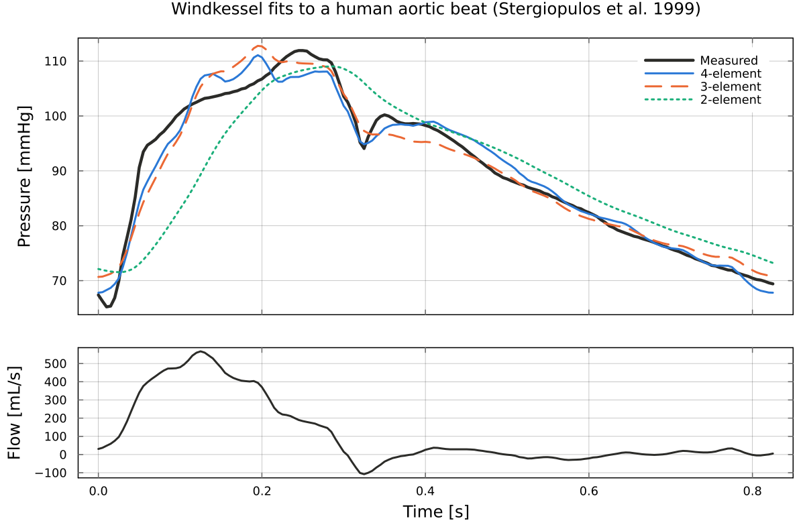

# WindkesselIdentification.jl

Fit 2-element, 3-element and parallel 4-element Windkessel models of the cardiac afterload to
measured aortic pressure and flow. The models are simulated in discrete time (exact zero-order
hold) and fitted by output-error minimisation with Newton's method, using exact gradients and
Hessians from forward-mode automatic differentiation.

The package is the code behind [Pigot et al. (2021), _Identification of cardiac afterload dynamics
from data_](https://doi.org/10.1016/j.ifacol.2021.10.307), IFAC-PapersOnLine 54(15), 508-513, and
ships the three data sets used there.

## Installation

```julia
] add WindkesselIdentification
```

## Quickstart

Fit the 4-element model to one human beat, with the initial state solved from periodicity at
every step:

```@example quickstart
using WindkesselIdentification

P, Q, h = load_stergiopulos1999()   # pressure [mmHg], flow [mL/s], h = 0.005 s
θ0 = [0.85, 1.5, 0.05, 0.006]       # start: Rp, C, Rc, L
θ, res = identify(θ0, solvex0(G(θ0, h), Q), Q, P, h; x0id=false, x0solve=true)
round.(θ, sigdigits=3)
```

The mean squared error of the simulated pressure, in mmHg^2:

```@example quickstart
Psim = simulate(θ, solvex0(G(θ, h), Q), Q, h)
round(sum(abs2, Psim - P) / length(P), sigdigits=3)
```

The 3-element model, with `θid` marking all three parameters as free:

```@example quickstart
θ3, _ = identify(θ0[1:3], solvex0(G3(θ0[1:3], h), Q), Q, P, h;
    θid=[1, 1, 1], x0id=false, x0solve=true, G_=G3)
round.(θ3, sigdigits=3)
```



## Models and units

The parallel 4-element model has impedance Z(s) = Rc + Rp/(1 + s C Rp) - Rc/(1 + s L/Rc), with
flow as input and pressure as output. The 3-element model is the limit L = Inf, and the 2-element
model has Rc = 0. `G(θ, h)` returns a ControlSystemsBase `StateSpace`, so `bode`, `lsim` and the
rest of that ecosystem apply.

| Quantity | Unit |
|---|---|
| pressure | mmHg |
| flow | mL/s (`Lmin_to_mLs`, `mLs_to_Lmin` convert from and to L/min) |
| time, h | s |
| Rp, Rc | mmHg s/mL |
| C | mL/mmHg |
| L | mmHg s^2/mL |
| state x1 | volume on C, mL |
| state x2 (4-element) | L times the flow through L, mmHg s |

## Identifiability

Fix the inertance L, refit the other three parameters, and plot how much worse the fit gets.
On the human beat the cost has a clear minimum. On the pig data it is flat for any L above about
0.3 mmHg s^2/mL, so L cannot be identified there and the 3-element model fits as well as the
4-element one.


## Data

- [`load_stergiopulos1999`](@ref): one type A beat from Figure 4A of [Stergiopulos et al.
  (1999)](https://doi.org/10.1152/ajpheart.1999.276.1.H81), digitised and resampled at 200 Hz.
- [`load_pig`](@ref): aortic pressure and flow from two 65 kg pigs, one heart beating in vivo and
  one beating ex vivo against a synthetic afterload, logged at 200 Hz. See the paper for details.

The `examples/` folder of the repository reproduces the paper's analysis: multiple
initialisation, Hessian condition numbers, Bode plots and persistence of excitation.

## Citing

Please cite the paper; the repository's `CITATION.cff` has the details.
